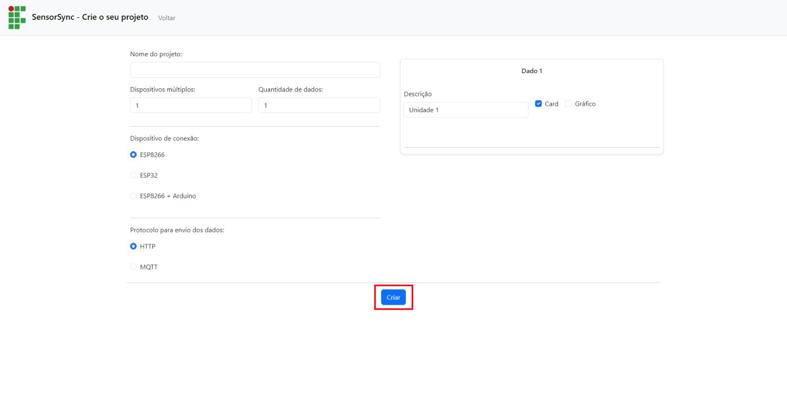
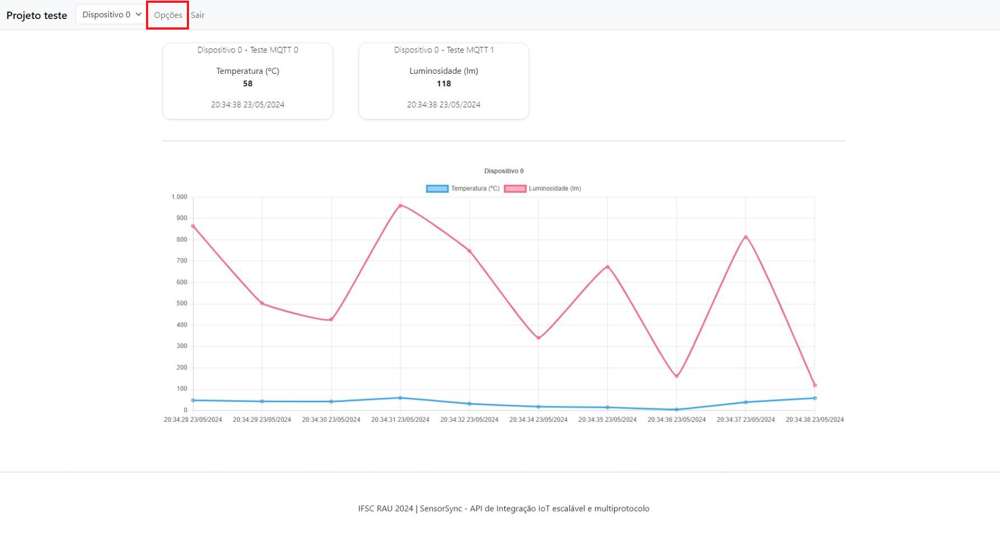

# SensorSync — plataforma IoT self-hosted

Plataforma para criar projetos IoT sem programar o backend: a interface web gera o dashboard, o banco de dados
e o código do microcontrolador (ESP8266/ESP32). Os dispositivos enviam dados por **HTTP** ou **MQTT**.
Roda em hardware de baixo custo (testado em Raspberry Pi 3) com Java 21, MySQL e Mosquitto.

Artigo: M. W. Sprotte, P. D. da Silva, A. A. de Melo, *An Easy-to-Use Platform for IoT Systems on Low-Cost Hardware*,
SIoT 2025, doi: [10.1109/SIoT68426.2025.11368827](https://doi.org/10.1109/SIoT68426.2025.11368827).

Biblioteca para as placas: [sensorsync_lib](https://github.com/mwsprotte/sensorsync_lib) (IDE Arduino › Gerenciar Bibliotecas › "SensorSync").

#### Sumário

- [Como usar](#como-usar)
- [Instalação no servidor (Linux / Raspberry Pi)](#instalação-no-servidor-linux--raspberry-pi)
- [TLS (HTTPS e MQTT criptografados)](#tls-https-e-mqtt-criptografados)
  - [Instalar a CA no navegador](#instalar-a-ca-no-navegador-tirar-o-aviso-não-seguro)
- [Atualizando da versão 0.x](#atualizando-da-versão-0x)
- [Ambiente de desenvolvimento (Windows)](#ambiente-de-desenvolvimento-windows)
  - [Testar o TLS no PC com uma placa](#testar-o-tls-no-pc-com-uma-placa)
- [API](#api)

<hr>

## Como usar

1. **Entrar.** Acesse `https://<servidor>:8443` (ou `http://<servidor>:8080` sem TLS) e faça login. Contas são criadas por um administrador em *Usuários*.
   Cada usuário vê apenas os próprios projetos; administradores veem todos.
2. **Criar projeto.** Informe nome, quantidade de dispositivos e as variáveis (ex.: Temperatura, Umidade), escolha a placa
   e o protocolo. A plataforma gera o código do microcontrolador já com o endereço do servidor e o **token** de cada dispositivo.

   

3. **Guardar os tokens.** O token aparece uma única vez (o servidor guarda só o hash). Se perder, gere um novo em
   *Dashboard › Dispositivos* — o antigo para de funcionar.
4. **Gravar a placa.** Na primeira vez, prepare a IDE Arduino pelo guia da plataforma (aba *Código › Guia passo a passo*,
   página `preparar-ide.html`): placas ESP32/ESP8266, biblioteca **SensorSync** (o `.zip` é baixado da própria plataforma)
   e **PubSubClient**. Depois preencha o Wi-Fi no código gerado e grave.
5. **Acompanhar.** O dashboard mostra o último valor de cada variável (cards) e o histórico (gráfico), por dispositivo.
   Em *Opções* há o relatório completo com exportação CSV.

   

Cada dispositivo só consegue gravar no próprio projeto: o servidor identifica projeto e dispositivo pelo token,
ignorando o que vier no corpo da mensagem.

<hr>

## Instalação no servidor (Linux / Raspberry Pi)

Testado com Ubuntu Server (use uma versão LTS), Java 21, MySQL 8 e Mosquitto 2.

```bash
sudo apt install openjdk-21-jre-headless mysql-server mosquitto mosquitto-clients
```

**Banco de dados** — crie um usuário próprio (não use o root):

```sql
CREATE DATABASE sensor_sync_data;
CREATE USER 'sensorsync'@'localhost' IDENTIFIED BY 'uma-senha-forte';
GRANT ALL ON sensor_sync_data.* TO 'sensorsync'@'localhost';
```

**Mosquitto** — placas conectam com TLS na 8883; a 1883 fica só para a API, dentro da máquina:

```bash
sudo cp deploy/mosquitto/sensorsync.conf /etc/mosquitto/conf.d/
```

**Aplicação**

```bash
sudo useradd --system --home /opt/sensorsync sensorsync
sudo mkdir -p /opt/sensorsync /etc/sensorsync
sudo cp sensorsync.jar /opt/sensorsync/
sudo install -m 755 deploy/tls/sensorsync-tls.sh /opt/sensorsync/
sudo cp deploy/sensorsync.env.example /etc/sensorsync/sensorsync.env   # edite as senhas
sudo chmod 600 /etc/sensorsync/sensorsync.env
sudo cp deploy/sensorsync-tls.service deploy/sensorsync.service /etc/systemd/system/
sudo systemctl daemon-reload && sudo systemctl enable sensorsync-tls sensorsync
sudo systemctl start sensorsync-tls && sudo systemctl restart mosquitto && sudo systemctl start sensorsync
journalctl -u sensorsync -f        # na primeira execução mostra a senha do admin, se não definida
```

A partir daí o Raspberry sobe sozinho a cada boot, na ordem certificados → Mosquitto → API.

**Relógio.** O Raspberry Pi não tem relógio próprio; as leituras recebem a hora do servidor. Garanta NTP
(`timedatectl status` deve mostrar *System clock synchronized: yes*); se a rede bloquear NTP externo,
aponte para o servidor NTP da instituição em `/etc/systemd/timesyncd.conf`.

### Configuração

Tudo por variáveis de ambiente (veja `deploy/sensorsync.env.example`):

| Variável | Padrão | Uso |
|---|---|---|
| `SENSORSYNC_DB_URL` / `_USER` / `_PASSWORD` | `localhost/sensor_sync_data`, `sensorsync`, vazio | Banco MySQL |
| `SENSORSYNC_PUBLIC_HOST` | endereço usado no navegador | Servidor que vai no código das placas |
| `SENSORSYNC_MQTT_BROKER` / `_USER` / `_PASSWORD` / `_TOPIC` | `tcp://localhost:1883`, vazio, vazio, `sensorsync` | Broker MQTT |
| `SENSORSYNC_ADMIN_LOGIN` / `_PASSWORD` | `admin`, aleatória | Primeiro administrador (só se o banco não tiver usuários) |
| `SENSORSYNC_ALLOW_LEGACY_INGEST` | `false` | Aceitar placas com a biblioteca 0.x (sem token) |
| `SENSORSYNC_PORT` | `8080` | Porta HTTP (sem o perfil `tls`) |
| `SPRING_PROFILES_ACTIVE` | `tls` no exemplo | `tls` liga HTTPS e MQTT com TLS; sem ele, tudo em HTTP/MQTT puro |
| `SENSORSYNC_TLS_DIR` | `/etc/sensorsync/tls` | Pasta dos certificados |
| `SENSORSYNC_TLS_KEY` | `ec` | `ec` (ECDSA P-256) ou `rsa` (RSA-2048); trocar cria uma CA nova |
| `SENSORSYNC_HTTPS_PORT` | `8443` | Porta HTTPS (perfil `tls`) |
| `SENSORSYNC_PLAIN_HTTP` | `redirect` | Porta 8080 com TLS ligado: `redirect`, `allow` (experimentos) ou `off` |
| `SENSORSYNC_MQTT_PUBLIC_PORT` | `8883` com TLS, `1883` sem | Porta MQTT no código das placas |
| `SENSORSYNC_METRICS` / `_FILE` | `false`, `metrics/ingest-metrics.csv` | Experimentos: log CSV por mensagem (latência, perda); ver [bench/README.md](bench/README.md) |

<hr>

## TLS (HTTPS e MQTT criptografados)

Com o perfil `tls` (padrão do `sensorsync.env.example`), ninguém precisa configurar certificado:

1. **Primeiro boot:** `sensorsync-tls.service` cria uma CA própria em `/etc/sensorsync/tls` (ECDSA P-256, 20 anos)
   e um certificado do servidor com todos os nomes e IPs da máquina, mais o `SENSORSYNC_PUBLIC_HOST`.
2. **Código das placas:** o gerador embute o certificado da CA e chama `useTLS(CA_CERT)`. A placa conecta em
   HTTPS (8443) ou MQTT com TLS (8883) e só aceita um servidor assinado por essa CA. O aluno só copia e grava.
3. **IP mudou?** No boot seguinte só o certificado do servidor é reemitido; a CA é a mesma, então as placas já
   gravadas continuam funcionando (desde que o endereço no sketch ainda seja válido: prefira IP fixo).
4. **Navegador:** a página mostra "Não seguro" até a CA ser instalada em cada PC que acessa a plataforma
   (veja [Instalar a CA no navegador](#instalar-a-ca-no-navegador-tirar-o-aviso-não-seguro)).

**O que fica protegido:** token das placas, dados enviados e senha de login trafegam criptografados; uma máquina na
rede não consegue copiar o token nem se passar pelo servidor. **O que não fica:** o broker continua aceitando
clientes anônimos na 8883 (a API descarta mensagens sem token válido, mas alguém na rede ainda pode inundar o tópico).

**Experimentos com e sem TLS:** `SENSORSYNC_PLAIN_HTTP=allow` mantém a 8080 aceitando HTTP puro ao lado da 8443; para
MQTT sem TLS a partir de outra máquina, troque `127.0.0.1` por `0.0.0.0` no `listener 1883` do Mosquitto. Volte ao
padrão depois. Para comparar RSA, use `SENSORSYNC_TLS_KEY=rsa` (cria outra CA: gere o código das placas de novo).


### Instalar a CA no navegador (tirar o aviso "Não seguro")

Faça uma vez em cada computador que acessa a plataforma. Troque `SERVIDOR` pelo IP ou nome do servidor.

**Atalho para alunos e administradores:** a tela de login tem o link *"Não seguro" no navegador? Instale o
certificado*, que abre `https://SERVIDOR:8443/certificado.html`. A página traz o comando abaixo pronto para copiar
(com o certificado dentro, sem depender da porta 8080), o botão de download, as impressões digitais para conferir e
os passos para Firefox e Android. Sem TLS, o link não aparece.

**Windows (Edge e Chrome): um comando.** Abra o PowerShell (não precisa ser administrador) e rode:

```powershell
Invoke-WebRequest http://SERVIDOR:8080/ca.crt -OutFile $env:TEMP\sensorsync-ca.crt
Import-Certificate -FilePath $env:TEMP\sensorsync-ca.crt -CertStoreLocation Cert:\CurrentUser\Root
```

O Windows abre um "Aviso de Segurança" com a impressão digital (Thumbprint): confirme com **Sim**. Feche todas as
janelas do navegador e abra de novo.

**Windows: pelo assistente**, se preferir clicar:

1. Abra `http://SERVIDOR:8080/ca.crt` (baixa `sensorsync-ca.crt`) e dê dois cliques no arquivo.
2. **Instalar Certificado…** › **Usuário Atual** › **Colocar todos os certificados no repositório a seguir** ›
   **Procurar** › **Autoridades de Certificação Raiz Confiáveis** › Avançar › Concluir › **Sim** no aviso.
3. Feche todas as janelas do navegador e abra de novo.

**Firefox:** usa um repositório próprio. *Configurações › Privacidade e Segurança › Certificados › Ver certificados ›
Autoridades › Importar…*, escolha o `sensorsync-ca.crt` e marque *Confiar nesta CA para identificar sites*.

**Android:** baixe `http://SERVIDOR:8080/ca.crt` e instale em *Configurações › Segurança › Mais configurações de
segurança › Instalar do armazenamento › Certificado CA* (o nome do menu varia por fabricante).

**É a CA certa?** Antes de confirmar, compare a impressão digital mostrada com a do servidor:

```bash
openssl x509 -in /etc/sensorsync/tls/ca.crt -noout -fingerprint -sha256   # no servidor
```

O Windows mostra o SHA-1 no aviso do comando acima; para conferir o SHA-1 use `-sha1` no lugar de `-sha256`.
O requerente do certificado é sempre `SensorSync CA <nome-do-servidor>`.

**Remover depois** (ex.: o servidor gerou uma CA nova): `certmgr.msc` › Autoridades de Certificação Raiz
Confiáveis › Certificados › apague "SensorSync CA ...".

<hr>

## Atualizando da versão 0.x

1. **Backup:** `mysqldump -u root -p sensor_sync_data > backup.sql`.
2. Instale como descrito acima, apontando para o mesmo banco.
3. Na primeira execução a plataforma migra o banco automaticamente:
   - senhas em texto puro viram hash BCrypt (todos continuam entrando com a mesma senha);
   - usuários antigos viram **administradores** (na 0.x todos tinham acesso de administrador) — rebaixe quem não deve ser;
   - projetos passam a pertencer ao primeiro administrador; transfira recriando quando necessário;
   - cada índice de dispositivo já usado vira um dispositivo **sem token**.
4. Enquanto as placas não forem regravadas, use `SENSORSYNC_ALLOW_LEGACY_INGEST=true`.
5. Em cada projeto, *Dashboard › Dispositivos › Gerar token*, copie o código gerado e regrave a placa com a biblioteca 1.x.
6. Com todas as placas atualizadas, volte `SENSORSYNC_ALLOW_LEGACY_INGEST=false`.

<hr>

## Ambiente de desenvolvimento (Windows)

- Instale [Java 21](https://adoptium.net/), [MySQL Server](https://dev.mysql.com/downloads/mysql/) e
  [Mosquitto](https://mosquitto.org/download/) (`mosquitto -v` para subir o broker).
- Crie o banco e o usuário como na seção do servidor.
- Rode com as variáveis de ambiente (PowerShell):

```powershell
$env:SENSORSYNC_DB_PASSWORD="uma-senha-forte"; $env:SENSORSYNC_ADMIN_PASSWORD="admin12345"
.\mvnw.cmd spring-boot:run
```

- Build do `.jar`: `.\mvnw.cmd package` (gera `target/sensorsync.jar`; os testes usam H2 em memória).

### Testar o TLS no PC com uma placa

Sem `SPRING_PROFILES_ACTIVE=tls` nada muda: HTTP na 8080, MQTT na 1883 e código gerado sem TLS.
Para testar com TLS (troque `192.168.0.50` pelo IP do PC na rede, visto no `ipconfig`):

1. **Certificados** (pelo WSL, porque o script é de Linux). A pasta `config/` é ignorada pelo Git, então as chaves
   não vão para o repositório. Sem root, o script avisa que pulou grupo e dono dos arquivos: é esperado.

   ```powershell
   cd C:\Development\sensorsync
   wsl sh -c "SENSORSYNC_TLS_DIR=/mnt/c/Development/sensorsync/config/tls SENSORSYNC_PUBLIC_HOST=192.168.0.50 sh deploy/tls/sensorsync-tls.sh"
   ```

   Se o IP do PC mudar, rode de novo: só o certificado do servidor é refeito, a CA (e as placas já gravadas) continuam valendo.

2. **Mosquitto com TLS.** Crie `config\mosquitto-dev.conf` e suba o broker com ele (se o serviço do Mosquitto do
   Windows estiver rodando, pare antes com `net stop mosquitto`):

   ```
   per_listener_settings false
   allow_anonymous true
   listener 1883 127.0.0.1
   listener 8883
   cafile C:\Development\sensorsync\config\tls\ca.crt
   certfile C:\Development\sensorsync\config\tls\server.crt
   keyfile C:\Development\sensorsync\config\tls\server.key
   ```

   ```powershell
   mosquitto -c config\mosquitto-dev.conf -v
   ```

3. **API com o perfil `tls`** (as mesmas variáveis podem ir na configuração de execução do IntelliJ):

   ```powershell
   $env:SPRING_PROFILES_ACTIVE="tls"
   $env:SENSORSYNC_TLS_DIR="C:/Development/sensorsync/config/tls"
   $env:SENSORSYNC_PUBLIC_HOST="192.168.0.50"
   $env:SENSORSYNC_DB_PASSWORD="uma-senha-forte"
   cd sensorsync; .\mvnw.cmd spring-boot:run
   ```

4. **Placa.** Abra `https://192.168.0.50:8443`. O navegador avisa sobre o certificado: aceite, ou instale o
   `ca.crt` com o comando de [Instalar a CA no navegador](#instalar-a-ca-no-navegador-tirar-o-aviso-não-seguro). Gere o código do projeto (já sai com a CA
   e as portas 8443/8883) e grave a placa.

Cuidados:

- **Firewall do Windows:** libere as portas 8443 e 8883 na rede privada (ele pergunta para o Java e o Mosquitto na
  primeira execução).
- **Endereço:** o `SERVIDOR` no código gerado precisa ser o mesmo IP do certificado (`SENSORSYNC_PUBLIC_HOST`).
  Se a placa reclamar de nome ou certificado no serial, confira isso primeiro.
- **Voltar ao modo sem TLS:** feche o terminal (ou `Remove-Item Env:SPRING_PROFILES_ACTIVE`) e suba o Mosquitto
  normalmente.

### Atualizar o SensorSync.zip servido pela plataforma

A plataforma serve uma cópia da biblioteca em `sensorsync/src/main/resources/static/downloads/SensorSync.zip` (botão
na aba *Código* e no guia `preparar-ide.html`), para funcionar mesmo sem internet. Ao mudar a biblioteca, gere o ZIP
de novo (PowerShell, com a `sensorsync_lib` no branch certo) e faça commit dele aqui:

```powershell
$tmp = Join-Path $env:TEMP 'SensorSync'; Remove-Item $tmp -Recurse -Force -ErrorAction Ignore
robocopy C:\Development\sensorsync_lib $tmp /E /XD .git .github /NFL /NDL /NJH /NJS /NP
Compress-Archive -Path $tmp -DestinationPath C:\Development\sensorsync\sensorsync\src\main\resources\static\downloads\SensorSync.zip -Force
```

O ZIP precisa ter a pasta `SensorSync/` na raiz (é o que a IDE espera em *Adicionar biblioteca .ZIP*); o comando acima
já faz assim. Atualize também a versão mostrada em `preparar-ide.html`.

<hr>

## API

Autenticação de usuário: sessão (navegador) ou HTTP Basic (scripts), ex.: `curl -u login:senha ...`.

**Ingestão (dispositivos, autenticação por token)**

| Método | Rota | Corpo |
|---|---|---|
| POST | `/api/ingest` com `Authorization: Bearer <token>` | `{"values":[21.5, 60.2, null]}` |
| MQTT | tópico `sensorsync` | `{"token":"<token>","values":[21.5, 60.2]}` |

**Leitura (interface máquina)** — retornam os últimos `n` registros:

- `GET /data/project/{projeto}/length/{n}`
- `GET /data/project/{projeto}/device/{indice}/length/{n}`
- `GET /data/project/{projeto}/device/{indice}/data/{variavel}/length/{n}`

**Projetos e dispositivos**

- `GET /project` · `POST /project` · `PUT /project/{id}` · `DELETE /project/{id}` · `DELETE /project/{id}/data`
- `GET|POST /project/{id}/devices` · `PUT|DELETE /project/{id}/devices/{deviceId}` · `POST /project/{id}/devices/{deviceId}/token`
- `GET /project/{id}/code?board=ESP32|ESP8266|ARDUINO_ESP8266&protocol=HTTP|MQTT&deviceId=`

**Usuários** (somente administrador): `GET|POST /user`, `PUT|DELETE /user/{id}`. Próprio usuário: `GET /api/me`, `POST /api/me/password`.
