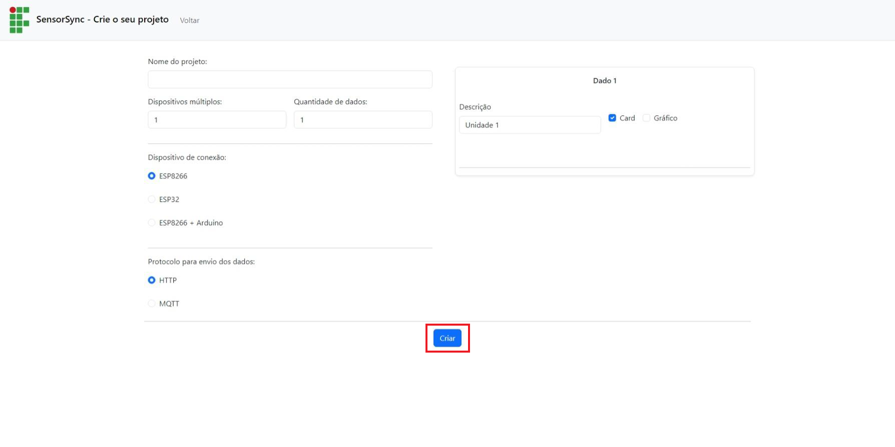
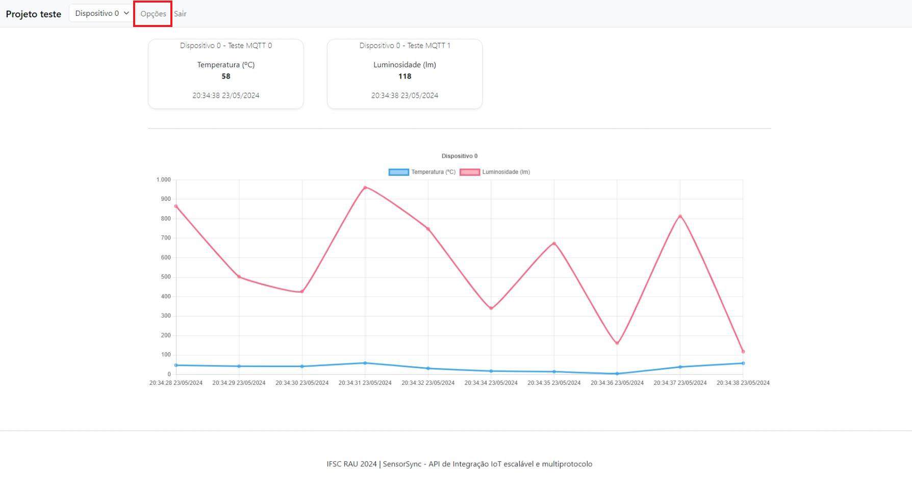

# SensorSync — plataforma IoT self-hosted

Plataforma para criar projetos IoT sem programar o backend: a interface web gera o dashboard, o banco de dados
e o código do microcontrolador (ESP8266/ESP32). Os dispositivos enviam dados por **HTTP** ou **MQTT**.
Roda em hardware de baixo custo (testado em Raspberry Pi 3) com Java 21, MySQL e Mosquitto.

Artigo: M. W. Sprotte, P. D. da Silva, A. A. de Melo, *An Easy-to-Use Platform for IoT Systems on Low-Cost Hardware*,
SIoT 2025, doi: [10.1109/SIoT68426.2025.11368827](https://doi.org/10.1109/SIoT68426.2025.11368827).

Biblioteca para as placas: [sensorsync_lib](https://github.com/mwsprotte/sensorsync_lib) (IDE Arduino › Gerenciar Bibliotecas › "SensorSync").

#### Sumário

- [Como usar](#como-usar)
- [Instalação no servidor (Linux / Raspberry Pi)](#instalação-no-servidor-linux--raspberry-pi)
- [Atualizando da versão 0.x](#atualizando-da-versão-0x)
- [Ambiente de desenvolvimento (Windows)](#ambiente-de-desenvolvimento-windows)
- [API](#api)

<hr>

## Como usar

1. **Entrar.** Acesse `http://<servidor>:8080` e faça login. Contas são criadas por um administrador em *Usuários*.
   Cada usuário vê apenas os próprios projetos; administradores veem todos.
2. **Criar projeto.** Informe nome, quantidade de dispositivos e as variáveis (ex.: Temperatura, Umidade), escolha a placa
   e o protocolo. A plataforma gera o código do microcontrolador já com o endereço do servidor e o **token** de cada dispositivo.

   

3. **Guardar os tokens.** O token aparece uma única vez (o servidor guarda só o hash). Se perder, gere um novo em
   *Dashboard › Dispositivos* — o antigo para de funcionar.
4. **Gravar a placa.** Instale a biblioteca **SensorSync** pela IDE Arduino, preencha o Wi-Fi no código gerado e grave.
5. **Acompanhar.** O dashboard mostra o último valor de cada variável (cards) e o histórico (gráfico), por dispositivo.
   Em *Opções* há o relatório completo com exportação CSV.

   

Cada dispositivo só consegue gravar no próprio projeto: o servidor identifica projeto e dispositivo pelo token,
ignorando o que vier no corpo da mensagem.

<hr>

## Instalação no servidor (Linux / Raspberry Pi)

Testado com Ubuntu Server (use uma versão LTS), Java 21, MySQL 8 e Mosquitto 2.

```bash
sudo apt install openjdk-21-jre-headless mysql-server mosquitto mosquitto-clients
```

**Banco de dados** — crie um usuário próprio (não use o root):

```sql
CREATE DATABASE sensor_sync_data;
CREATE USER 'sensorsync'@'localhost' IDENTIFIED BY 'uma-senha-forte';
GRANT ALL ON sensor_sync_data.* TO 'sensorsync'@'localhost';
```

**Mosquitto** — para aceitar conexões das placas na rede, crie `/etc/mosquitto/conf.d/sensorsync.conf`:

```
listener 1883
allow_anonymous true
```

> O broker ainda é anônimo: qualquer máquina da rede pode publicar ou ler o tópico. Mensagens sem token válido
> são descartadas pela plataforma, mas restrinja a porta 1883 à rede do laboratório no firewall.

**Aplicação**

```bash
sudo useradd --system --home /opt/sensorsync sensorsync
sudo mkdir -p /opt/sensorsync /etc/sensorsync
sudo cp sensorsync.jar /opt/sensorsync/
sudo cp deploy/sensorsync.env.example /etc/sensorsync/sensorsync.env   # edite as senhas
sudo chmod 600 /etc/sensorsync/sensorsync.env
sudo cp deploy/sensorsync.service /etc/systemd/system/
sudo systemctl daemon-reload && sudo systemctl enable --now sensorsync
journalctl -u sensorsync -f        # na primeira execução mostra a senha do admin, se não definida
```

**Relógio.** O Raspberry Pi não tem relógio próprio; as leituras recebem a hora do servidor. Garanta NTP
(`timedatectl status` deve mostrar *System clock synchronized: yes*); se a rede bloquear NTP externo,
aponte para o servidor NTP da instituição em `/etc/systemd/timesyncd.conf`.

### Configuração

Tudo por variáveis de ambiente (veja `deploy/sensorsync.env.example`):

| Variável | Padrão | Uso |
|---|---|---|
| `SENSORSYNC_DB_URL` / `_USER` / `_PASSWORD` | `localhost/sensor_sync_data`, `sensorsync`, vazio | Banco MySQL |
| `SENSORSYNC_PUBLIC_HOST` | endereço usado no navegador | Servidor que vai no código das placas |
| `SENSORSYNC_MQTT_BROKER` / `_USER` / `_PASSWORD` / `_TOPIC` | `tcp://localhost:1883`, vazio, vazio, `sensorsync` | Broker MQTT |
| `SENSORSYNC_ADMIN_LOGIN` / `_PASSWORD` | `admin`, aleatória | Primeiro administrador (só se o banco não tiver usuários) |
| `SENSORSYNC_ALLOW_LEGACY_INGEST` | `false` | Aceitar placas com a biblioteca 0.x (sem token) |
| `SENSORSYNC_PORT` | `8080` | Porta HTTP |

<hr>

## Atualizando da versão 0.x

1. **Backup:** `mysqldump -u root -p sensor_sync_data > backup.sql`.
2. Instale como descrito acima, apontando para o mesmo banco.
3. Na primeira execução a plataforma migra o banco automaticamente:
   - senhas em texto puro viram hash BCrypt (todos continuam entrando com a mesma senha);
   - usuários antigos viram **administradores** (na 0.x todos tinham acesso de administrador) — rebaixe quem não deve ser;
   - projetos passam a pertencer ao primeiro administrador; transfira recriando quando necessário;
   - cada índice de dispositivo já usado vira um dispositivo **sem token**.
4. Enquanto as placas não forem regravadas, use `SENSORSYNC_ALLOW_LEGACY_INGEST=true`.
5. Em cada projeto, *Dashboard › Dispositivos › Gerar token*, copie o código gerado e regrave a placa com a biblioteca 1.x.
6. Com todas as placas atualizadas, volte `SENSORSYNC_ALLOW_LEGACY_INGEST=false`.

<hr>

## Ambiente de desenvolvimento (Windows)

- Instale [Java 21](https://adoptium.net/), [MySQL Server](https://dev.mysql.com/downloads/mysql/) e
  [Mosquitto](https://mosquitto.org/download/) (`mosquitto -v` para subir o broker).
- Crie o banco e o usuário como na seção do servidor.
- Rode com as variáveis de ambiente (PowerShell):

```powershell
$env:SENSORSYNC_DB_PASSWORD="uma-senha-forte"; $env:SENSORSYNC_ADMIN_PASSWORD="admin12345"
.\mvnw.cmd spring-boot:run
```

- Build do `.jar`: `.\mvnw.cmd package` (gera `target/sensorsync.jar`; os testes usam H2 em memória).

<hr>

## API

Autenticação de usuário: sessão (navegador) ou HTTP Basic (scripts), ex.: `curl -u login:senha ...`.

**Ingestão (dispositivos, autenticação por token)**

| Método | Rota | Corpo |
|---|---|---|
| POST | `/api/ingest` com `Authorization: Bearer <token>` | `{"values":[21.5, 60.2, null]}` |
| MQTT | tópico `sensorsync` | `{"token":"<token>","values":[21.5, 60.2]}` |

**Leitura (interface máquina)** — retornam os últimos `n` registros:

- `GET /data/project/{projeto}/length/{n}`
- `GET /data/project/{projeto}/device/{indice}/length/{n}`
- `GET /data/project/{projeto}/device/{indice}/data/{variavel}/length/{n}`

**Projetos e dispositivos**

- `GET /project` · `POST /project` · `PUT /project/{id}` · `DELETE /project/{id}` · `DELETE /project/{id}/data`
- `GET|POST /project/{id}/devices` · `PUT|DELETE /project/{id}/devices/{deviceId}` · `POST /project/{id}/devices/{deviceId}/token`
- `GET /project/{id}/code?board=ESP32|ESP8266|ARDUINO_ESP8266&protocol=HTTP|MQTT&deviceId=`

**Usuários** (somente administrador): `GET|POST /user`, `PUT|DELETE /user/{id}`. Próprio usuário: `GET /api/me`, `POST /api/me/password`.
